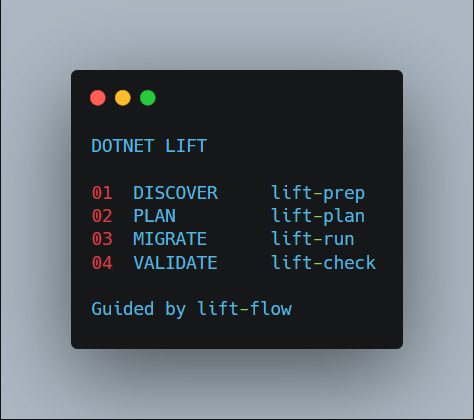
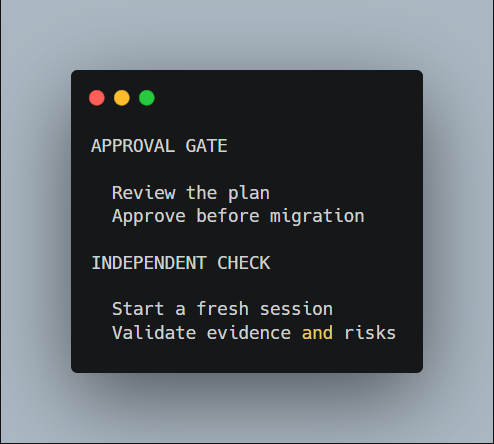

# Dotnet Lift Skills

**Modernize legacy .NET with a plan, evidence, and a human in control.**

Dotnet Lift gives your AI coding agent a reusable workflow for moving from discovery to an approved migration—and then to independent validation. Use it with **GitHub Copilot**, **Claude Code**, or **OpenAI Codex**.



**[Quick start](#tldr)** · **[The workflow](#the-workflow-step-by-step)** · **[Generated files](#your-upgrade-files)** · **[Other installs](#other-ways-to-install)** · **[Update or uninstall](#update-or-uninstall)**

> [!IMPORTANT]
> You approve the migration before execution. Independent validation is started separately, in a fresh session. A successful build alone is not proof of a successful migration.

## TL;DR

**1. Install.** Open a terminal in the root of the .NET repository you want to migrate:

```bash
npx skills add sajagjain/dotnet-lift
npx skills list
git status --short
```

If prompted, select **all five skills** and your coding agent. You need [Node.js/npm](https://nodejs.org/) for `npx`. No clone or global CLI installation is required.

Project-level installation can itself create or change files in the worktree. Check `git status` before starting: the branch setup requires a clean worktree for a new run. Decide how to preserve any changes, including installed skill files, or use a global installation (`npx skills add sajagjain/dotnet-lift -g`) if appropriate. Never discard work just to proceed.

**2. Start.** Open or restart your agent in the same repository and send this **chat prompt** (not a terminal command):

> Use `lift-flow` to modernize this application. Start with readiness, present the migration plan for my approval, and preserve existing behavior.

The agent will check the worktree and ask about creating an upgrade branch, discover the application, and present a plan and decisions. Review the plan before explicitly approving execution; answer any later questions if new risks arise.

If the final plan is acceptable, give explicit approval in chat, for example:

> Approve `UPGRADE_PLAN.md` for execution with its stated scope and exclusions.

**3. Validate.** After execution is complete, start a **fresh agent session** in the same repository and send:

> Use `lift-check` to independently validate the completed migration against the original application, plan, and execution evidence.

Read the [generated reports](#your-upgrade-files), complete any applicable manual checks, and resolve outstanding risks before deployment. Validation is not started automatically.

Skills are reusable instructions for an AI agent, not standalone migration commands. See the [`npx skills` CLI documentation](https://www.skills.sh/docs/cli) for installation options.

## Why Dotnet Lift?

Legacy modernization is more than changing a target framework. Dotnet Lift helps an agent:

- **Discover before changing** — inventory application behavior, dependencies, data, integrations, and UI.
- **Keep you in control** — surface decisions and risks, and require approval before execution.
- **Protect what matters** — track feature, route, UI, database, identity, and integration continuity.
- **Show its work** — connect source features to migration tasks and validation evidence; flag what could not be tested.
- **Check independently** — review the result in a separate session rather than treating compilation as proof.

These are workflow safeguards, not a guarantee of migration success. Your review and validation remain essential.

## Meet the skills

| Skill | Your agent's job | Key output |
| --- | --- | --- |
| [`lift-flow`](skills/lift-flow/SKILL.md) | Coordinate the workflow and approval gates. | `UPGRADE_STATUS.md`, `UPGRADE_APPROVAL.md` |
| [`lift-prep`](skills/lift-prep/SKILL.md) | Discover the application and its migration risks. | `UPGRADE_READINESS.md`, `UPGRADE_COVERAGE.md` |
| [`lift-plan`](skills/lift-plan/SKILL.md) | Turn findings into an actionable plan for approval. | `UPGRADE_PLAN.md` |
| [`lift-run`](skills/lift-run/SKILL.md) | Execute the approved migration incrementally. | `UPGRADE_EXECUTION_LOG.md` |
| [`lift-check`](skills/lift-check/SKILL.md) | Independently validate the result and report regressions. | `UPGRADE_VALIDATION.md`, `REGRESSION_REPORT.md` |

Use the skills individually, or start with `lift-flow`. The workflow deliberately keeps migration execution behind explicit approval. Independent validation is a separate, user-initiated step.

## The workflow, step by step

| Step | What happens | What you do |
| --- | --- | --- |
| **Set up** | `lift-flow` checks the worktree before creating reports. | Review any existing changes and authorize a new upgrade branch if appropriate. The agent must not discard your work. |
| **Discover** | `lift-prep` inventories projects, features, UI, data, integrations and risks. | Review readiness findings and any unknown or inaccessible areas. |
| **Plan** | `lift-plan` maps the work, dependencies, tests and risks. Known material decisions are grouped for review. | Answer applicable questions and review the plan, scope, exclusions and rollback strategy. |
| **Approve** | The coordinator records your explicit approval against the exact plan. | Approve the plan for execution, or request changes. A changed plan requires renewed approval. |
| **Migrate** | `lift-run` implements approved tasks, checks changes and records evidence. | At checkpoints, choose whether to commit, continue or pause. Schema operations and commits need their own authorization; new risks can still require decisions. |
| **Validate** | In a fresh session, `lift-check` independently reviews the migration and produces two reports. | Start the check yourself; review findings and perform or assign manual checks. |



For a narrower start, ask your agent to use `lift-prep` for discovery only. You can invoke individual skills by name, but `lift-run` still requires the readiness report, approved plan and approval record. `lift-check` must be started independently after execution.

On large repositories, the skills use bounded subagents by default when supported, with findings reconciled into a coverage ledger. If subagents are unavailable, work is batched instead. The ledger helps track what was examined; it does not prove behavioral parity.

## Your upgrade files

The agent creates or updates these Markdown (`.md`) files in the **target application's repository**, not in this skills repository. They appear as the workflow progresses; the approval file is created only after explicit approval, and the final two reports only when you start independent validation. `UPGRADE_STATUS.md` is maintained by `lift-flow`; individual skills may not produce it.

Open the files in VS Code or any text editor. In VS Code, select a Markdown file and use **Open Preview** to read its headings, tables and checklists. Start with the summary, then follow feature/task IDs and evidence links to the relevant details. Ask your agent to explain an item if needed, but inspect the cited evidence yourself.

| File | When it appears | What it means and what to read |
| --- | --- | --- |
| `UPGRADE_STATUS.md` | Throughout `lift-flow` | The workflow dashboard: current stage, blockers, decisions and progress metrics. Read this first to see where to resume. |
| `UPGRADE_COVERAGE.md` | Discovery; updated at checkpoints | The inventory and coverage ledger for original files, projects and features. Check pending, partial or blocked entries and baseline limitations before assuming anything was covered. |
| `UPGRADE_READINESS.md` | After discovery | A snapshot of the original application, its behavior, dependencies and migration risks. Review the summary, inventory, unknowns and high-risk findings. |
| `UPGRADE_PLAN.md` | After planning | The proposed migration specification: scope, decisions, tasks, source-to-target mapping, acceptance criteria, rollback and manual checks. Review it before approving execution. |
| `UPGRADE_APPROVAL.md` | After you explicitly approve the plan | The authorization record for a specific plan and its SHA-256 fingerprint. Check the approved scope and conditions; it is not separate approval for schema changes, commits or retirement. |
| `UPGRADE_EXECUTION_LOG.md` | During migration | The record of tasks, changes, checks, evidence, blockers and manual validation still needed. Use it to see what actually happened, not just what was planned. |
| `UPGRADE_VALIDATION.md` | After the separate `lift-check` | The independent assessment: overall result, matrices, evidence, unverified areas and production-readiness limitations. Read the result and user actions first. |
| `REGRESSION_REPORT.md` | After the separate `lift-check` | A focused list of confirmed differences, missing functionality or assets, untested areas and corrective actions. Use it to prioritize fixes and manual checks. |

**Reading progress:** percentages include a numerator, denominator, definition and exclusions. They are indicators, not a pass by themselves. *Implemented* is not the same as *validated*; **Not Tested**, **Partially Validated** and **Blocked** need attention. Where a check cannot run, use the manual checklist in the plan, execution log or validation reports for prerequisites, steps, expected results and evidence. A successful build alone does not establish parity.

Keep credentials and secrets out of reports and prompts. Do not retire the legacy application or deploy solely because migration tasks are complete: review the independent findings, outstanding risks and rollback readiness, and authorize retirement separately.

## Other ways to install

The skills use the open `SKILL.md` format. Claude Code and GitHub Copilot CLI also support the plugin packages below; both use the same skill definitions.

### Install as a plugin

#### Claude Code

In Claude Code, add the marketplace and install the plugin:

```text
/plugin marketplace add sajagjain/dotnet-lift
/plugin install dotnet-lift@dotnet-lift-marketplace
```

Or use the CLI:

```sh
claude plugin marketplace add sajagjain/dotnet-lift
claude plugin install dotnet-lift@dotnet-lift-marketplace
```

#### GitHub Copilot CLI

Register the marketplace and install the plugin:

```sh
copilot plugin marketplace add sajagjain/dotnet-lift
copilot plugin install dotnet-lift@dotnet-lift-skills
```

Copilot CLI plugin installation is separate from availability in other Copilot clients. See the [Copilot plugin documentation](https://docs.github.com/en/copilot/concepts/customizations/plugins) for supported surfaces and current setup steps.

### Copy skills into a project

You can also use the skills without installing a plugin. Copy the `skills/` directory into the agent skills directory supported by your tool:

| Tool | Project-level skills directory |
| --- | --- |
| GitHub Copilot | `.github/skills/` |
| Claude Code | `.claude/skills/` |
| OpenAI Codex | `.agents/skills/` |

For example, to use `lift-prep` with Copilot, copy `skills/lift-prep/` to `.github/skills/lift-prep/`. Each skill folder must retain its `SKILL.md` file. Repeat for the skills you want available; copy all five to use the complete workflow. Check your agent tool's documentation for any changes to supported skill locations or discovery behavior.

Then open the target .NET repository in your agent and invoke the desired skill by name, such as `lift-prep` or `lift-flow`.

## Requirements and limitations

- These skills provide instructions to an AI agent; they do not themselves install .NET SDKs, execute migrations, or guarantee a successful result.
- The agent needs access to the target repository and the tools required to inspect, build, and test that application.
- Review generated plans and changes before approving or applying them. Availability of framework versions, packages, infrastructure, and agent capabilities may affect results.
- `lift-flow` expects the other skill folders to be available to the agent when it coordinates the workflow.

## Contributing

Issues and pull requests are welcome. Keep skill names short, ensure each directory name matches its `SKILL.md` frontmatter `name`, and update cross-skill references when changing the workflow.

## License

This project is licensed under the [MIT License](LICENSE).

## Update or uninstall

Use the instructions for the way you installed Dotnet Lift. If you installed it in more than one way, manage each installation separately. Updates may overwrite local changes to skill files, so back up any edits you want to keep first.

### Installed with `npx skills`

Open a terminal in the .NET project where you installed the skills. To update just the five Dotnet Lift skills in that project:

```sh
npx skills update -p lift-flow lift-prep lift-plan lift-run lift-check
```

To uninstall them from the project:

```sh
npx skills remove lift-flow lift-prep lift-plan lift-run lift-check
```

Follow the prompts and check the selected agents and skills before confirming. To manage a global installation instead, replace `-p` with `-g` for the update command, or add `-g` to the remove command. Use `npx skills list` for project skills or `npx skills list -g` for global skills.

### Installed as a Claude Code plugin

In a terminal, refresh the marketplace and update the plugin:

```sh
claude plugin marketplace update dotnet-lift-marketplace
claude plugin update dotnet-lift@dotnet-lift-marketplace
```

To uninstall:

```sh
claude plugin uninstall dotnet-lift@dotnet-lift-marketplace
```

The uninstall command defaults to user scope. If you installed it for a project or locally, run it from that project and add `--scope project` or `--scope local`. Uninstalling from the last scope also removes the plugin's stored options and data; add `--keep-data` to preserve its data directory. Use `claude plugin list` to check the installed scope. In an open Claude Code session, run `/reload-plugins` or start a new session to apply changes.

### Installed as a GitHub Copilot CLI plugin

In a terminal, refresh the marketplace and update the plugin:

```sh
copilot plugin marketplace update dotnet-lift-skills
copilot plugin update dotnet-lift@dotnet-lift-skills
```

To uninstall:

```sh
copilot plugin uninstall dotnet-lift@dotnet-lift-skills
```

Use `copilot plugin list` to check installed plugins, then start a new session to load changes. Plugin updates depend on a newer version being published in the marketplace.

### Copied manually

To update, download the latest repository and replace only the Dotnet Lift skill folders you originally copied into your agent's project skills directory. Compare and preserve any local edits first.

To uninstall, remove only the copied `lift-flow`, `lift-prep`, `lift-plan`, `lift-run`, and `lift-check` folders from that directory. Do not remove the entire skills directory if it contains other skills. Restart your agent session afterward.
